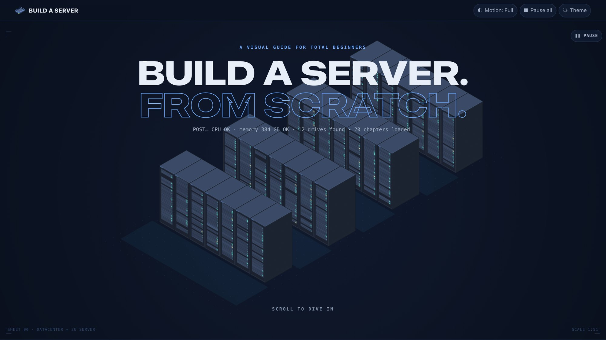
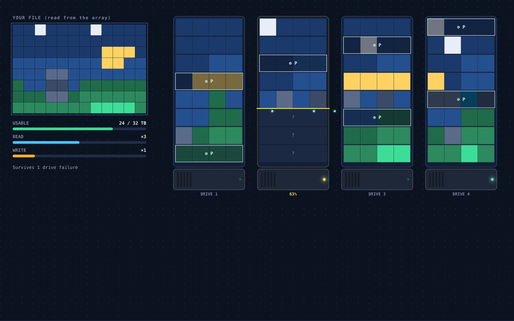
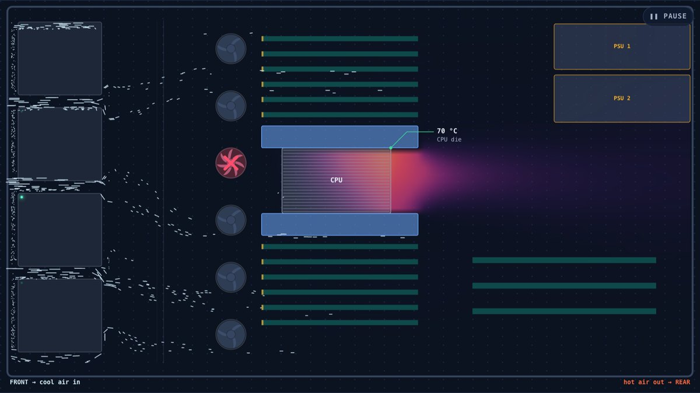
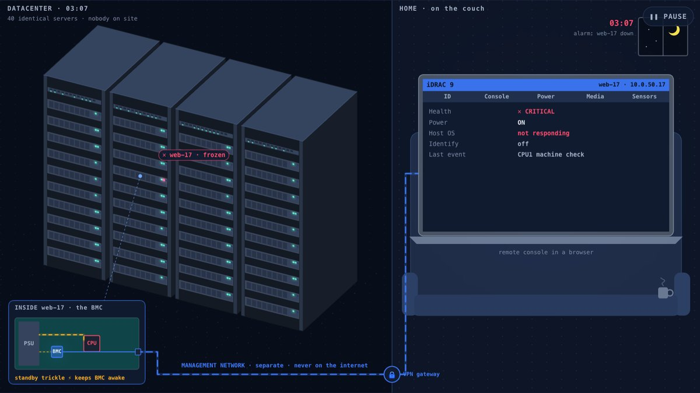
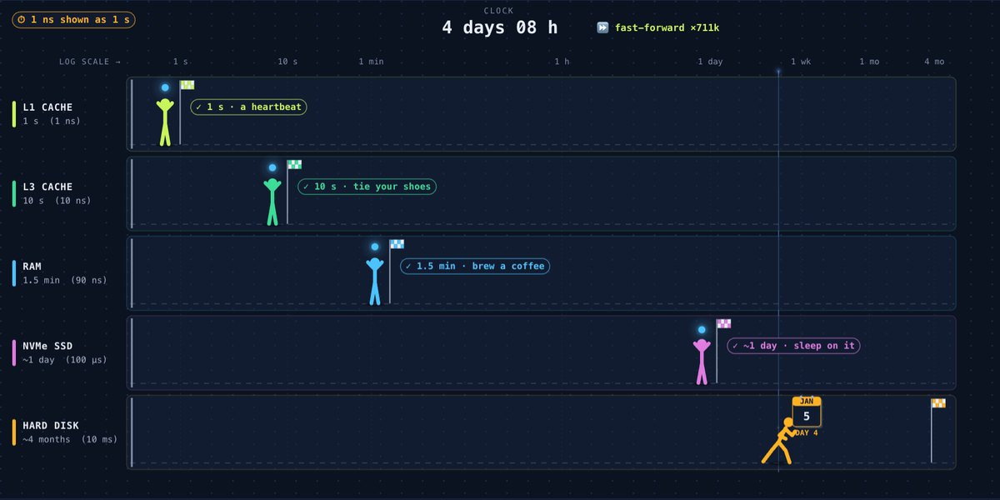
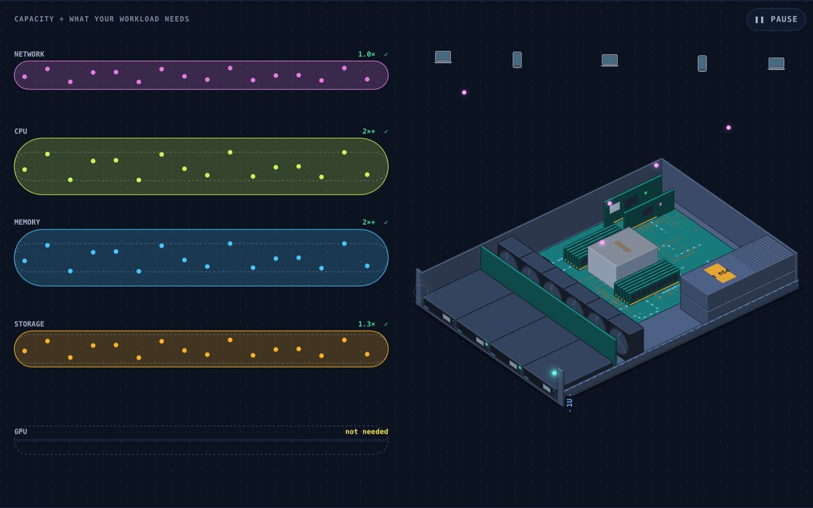
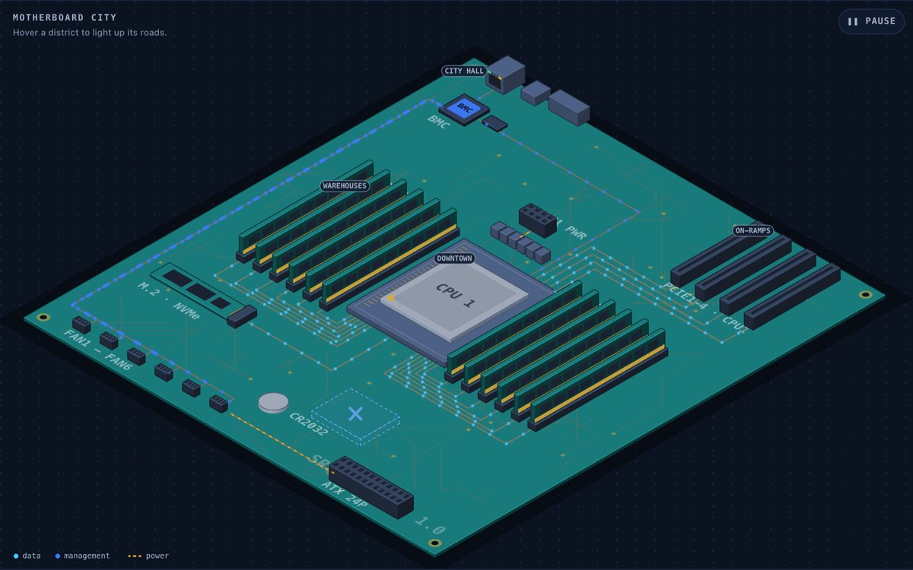
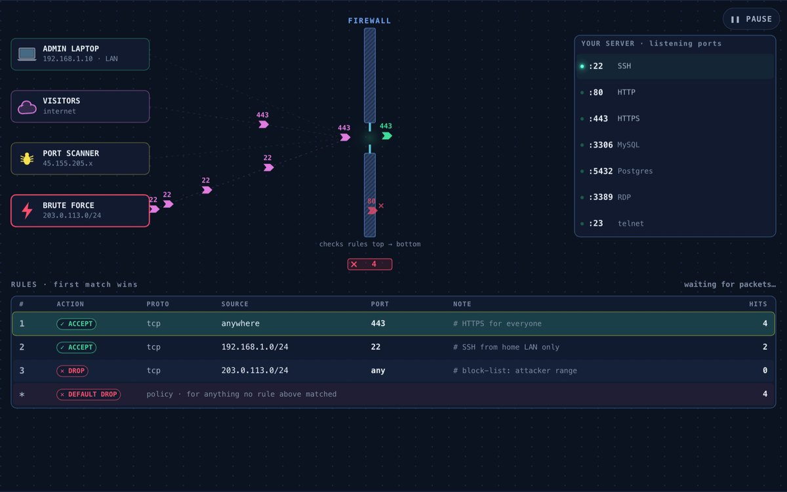
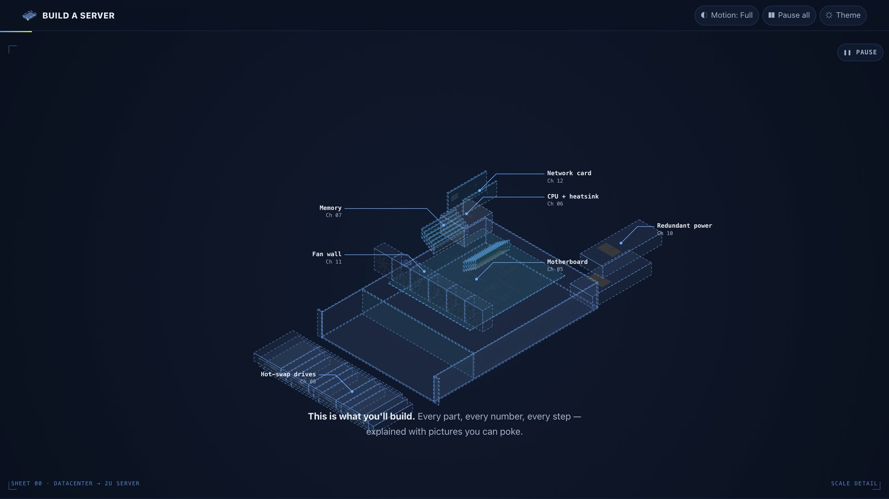

<div align="center">



# Build a Server From Scratch

**An interactive, visual-first course that teaches total beginners how to choose, build and run their own server.**

Every diagram, animation and simulation is drawn live in the browser with hand-written JavaScript.
No frameworks. No libraries. No image files. No build step.

### [▶ Try it live](https://shuvrowritescode.github.io/build-a-server-from-scratch/)

[](LICENSE)


[](#contributing)

[**Live demo**](https://shuvrowritescode.github.io/build-a-server-from-scratch/) · [Getting started](#getting-started) · [What you'll learn](#what-youll-learn) · [Gallery](#gallery) · [How it works](#how-it-works) · [Contributing](#contributing)

</div>

---

## Why this exists

Most server guides are walls of text and spec tables. Beginners don't struggle to *read* that RAID 5 survives one failure. They struggle to *see* why. This project teaches by doing:

- **Kill a drive** and watch real XOR parity rebuild the missing bytes.
- **Fail a fan** and watch a hot pocket form behind it as the CPU heads for throttling.
- **Pull a power supply** and see the second PSU take the full load (or watch the whole rack go dark if both are on one circuit).
- **Race a hard drive against RAM** with time slowed so that 1 nanosecond lasts 1 second.

Each chapter keeps the text to a few short cards. The visual carries the lesson.

## What you'll learn

The course is one page with **20 chapters in five parts**. It starts by choosing where to buy a server and ends with your first live request.

| Part | Chapters | Highlights |
|---|---|---|
| **A · Plan** | What a server is · Start with the job · Buy, build or refurb | Desktop → server morph, workload heat map, 5-year true-cost calculator (Dell PowerEdge, HPE ProLiant, Lenovo ThinkSystem, Supermicro, DIY, refurbished) |
| **B · Hardware** | Chassis & rack units · Motherboard & PCIe · CPU · Memory · Storage · RAID · Power · Cooling · Networking · BMC · GPUs | Rack builder, PCIe lane budget, CPU "kitchen" scheduler, latency race, ECC cosmic-ray demo, RAID lab, PSU failover, wind tunnel, pipe race, iDRAC/iLO remote fix, VRAM fit check |
| **C · Build** | Putting it together | 10-step guided assembly bench: ESD, CPU orientation, thermal paste, cross-pattern screws, DIMM population, shroud |
| **D · Software** | First power-on · Installing the OS · Connect & lock down · Watch & back up | POST boot relay, keyboard-driven BIOS, firmware order, OS decision tree, hypervisor layer cake, SSH keys, firewall rule engine, 3-2-1 disaster game |
| **E · Go live** | First service + configurator | Request journey to "Hello from my server!" and a workload configurator that finds your bottleneck |

The page also has a 63-term searchable glossary, a 19-item launch checklist, and a persistent **build tracker**. The tracker is a mini server whose parts ink in from blueprint as you finish each chapter.

## Gallery

<table>
  <tr>
    <td width="50%"><br><sub><b>RAID lab</b>: real XOR (RAID 5) and Reed–Solomon (RAID 6) parity. Kill drives, rebuild, or "delete the file" to learn why RAID isn't a backup.</sub></td>
    <td width="50%"><br><sub><b>Wind tunnel</b>: a live airflow and heat simulation. Dead fans, missing shrouds and clogged intakes all change the CPU temperature.</sub></td>
  </tr>
  <tr>
    <td><br><sub><b>Lights out, 3 AM</b>: find, inspect and power-cycle a frozen server from your couch through its BMC.</sub></td>
    <td><br><sub><b>Latency race</b>: L1 cache, RAM, NVMe and HDD at human scale (1 ns = 1 s).</sub></td>
  </tr>
  <tr>
    <td><br><sub><b>Configurator</b>: pick a workload. The narrowest pipe is your bottleneck, and the server assembles from your parts.</sub></td>
    <td><br><sub><b>Motherboard city</b>: sockets, DIMM channels, PCIe lanes and NUMA latency, explained as a city map.</sub></td>
  </tr>
  <tr>
    <td><br><sub><b>Firewall gatekeeper</b>: ordered rules, real CIDR matching, first match wins.</sub></td>
    <td><br><sub><b>The dive</b>: scroll the hero to slide a server out of its rack and explode it into a labelled blueprint.</sub></td>
  </tr>
</table>

## Getting started

The quickest way in is the live site: **[shuvrowritescode.github.io/build-a-server-from-scratch](https://shuvrowritescode.github.io/build-a-server-from-scratch/)**. Nothing to install.

### Open it locally

```bash
git clone https://github.com/ShuvroWritesCode/build-a-server-from-scratch.git
cd build-a-server-from-scratch
```

Then **double-click `index.html`**. It runs straight from `file://` because the code uses classic scripts with no ES modules and no `fetch`.

To serve it over HTTP instead:

```bash
python3 -m http.server 8080
```

Then open <http://localhost:8080>.

### Deploy

The site is static files, so any static host works.

- **GitHub Pages:** *Settings → Pages → Deploy from branch → `main` / root*.
- **Cloudflare Workers (static assets):** point `assets.directory` at the repository root in `wrangler.jsonc` and run `npx wrangler deploy`. No Worker script is needed.
- **Netlify, Vercel or S3:** upload the folder as is.

## Features

- **47 interactive visuals.** Each one animates and responds to sliders, toggles, drags or "break it" buttons.
- **No external dependencies.** The project hand-writes its easing, tweening, seeded RNG, colour math, isometric projection with depth sorting, particle systems and the airflow solver.
- **Simplified but honest simulations:**
  - RAID 5 uses real XOR and RAID 6 uses real GF(2⁸) Reed–Solomon parity over real bytes.
  - Airflow is a Darcy/potential-flow model with fan curves, plus heat advection and diffusion.
  - The CPU kitchen is a scheduling simulation with SMT stalls.
  - The firewall uses real CIDR matching and first-match-wins rule ordering.
- **One coherent art direction ("Lights-Out Blueprint").** Every part is drawn to real millimetre scale in a single isometric projection. Parts "ink in" from wireframe as you learn them.
- **Shared state across chapters.** The parts you choose for the power budget feed the configurator and other visuals, and progress persists in `localStorage`.
- **Dark and light themes**, with all canvas colours driven by CSS design tokens.
- **Sound and touch, opt-in.** A header *Sound* toggle adds a fan hum and airflow bed to the wind tunnel and the power-supply lab, driven live by the simulation (rpm sets pitch and level, a clogged intake muffles the air, dead fans thin the chorus), plus one-shot effects for failures and a BMC-style beep when the CPU throttles. Every sound is synthesized by `tools/make_sounds.py` using only the Python standard library and committed as base64 PCM in `js/data/sounds.js`; there are no audio files and no audio libraries. On phones and tablets, breaking something (a fan, a drive, a power supply, the file) also gives a short vibration.

### Accessibility

- **Motion:** levels are Full, Calm and Off, set from `prefers-reduced-motion` by default. There's also a global *Pause all*, and every looping visual has its own play/pause control.
- **Sound:** off by default and never autoplays; the *Sound* button is the unlocking gesture. Voices follow the same pause, offscreen and tab-hidden rules as animation, so a paused visual is a silent one. Vibration fires only on failure states, never for success, and only on devices with a coarse pointer.
- **Screen readers:** every visual has a text description that updates as its state changes, and throttled live-region announcements.
- **Controls:** every canvas interaction has a real DOM control (button, slider, toggle, select). There are no drag-only actions.
- **Colour:** status is never shown by colour alone. Glyphs (✓ ⚠ ✕), hatching and numbers back it up, and the heat ramp has monotonic luminance.
- **Without JavaScript:** the prose and all text alternatives remain readable.

### Performance

- **One loop:** a single `requestAnimationFrame` scheduler drives every visual and sleeps when nothing moves.
- **Lazy loading:** each visual's script is injected only as it nears the viewport, and visuals pause when offscreen.
- **Hot paths:** typed-array particle pools, cached glow sprites (no `shadowBlur`), HiDPI canvases capped at 2× DPR, and adaptive quality tiers.
- **Measured** in headless Chrome: 60 fps with 0–3 ms of script per frame per visual, at both desktop width and 390 px mobile.

## How it works

```
index.html            All prose + <figure data-visual="id"> hosts with text alternatives
css/
  tokens.css          Design tokens: palette (dark + light), type scale, motion
  base.css            Layout, header, TOC rail, chapters, scrolly sections
  visuals.css         Figure stages, control tray, tracker
js/
  core/
    ns.js             window.SRV namespace + event bus
    util.js           Math, easing, seeded RNG, colour utilities, heat LUT
    engine.js         Scheduler, tweens, lazy loader, Visual lifecycle, controls, scroll progress
    draw.js           2D toolkit: labels, leader/dimension lines, glows, LEDs, fans, glyph set
    iso.js            Isometric camera, face-local decal painting, shading, painter's sort
    models.js         Shared server models (2U chassis, parts, rack)
    store.js          Tiny reactive store
    audio.js          Web Audio layer: on-demand PCM decode, per-visual looping voices, one-shots
    haptics.js        Vibration API wrapper (phones/tablets only, failures only)
  data/data.js        Glossary, checklist, workloads, parts catalogue, shared build store
  data/sounds.js      GENERATED sound effects as base64 PCM (see tools/make_sounds.py)
  ui/                 Page chrome (TOC, progress, theme, glossary) and the build tracker
  visuals/<id>.js     One file per visual, loaded on demand
  main.js             Boot sequence
tools/make_sounds.py  Synthesizes every sound effect with the Python standard library → js/data/sounds.js
docs/screenshots/     Images for this README only (the site itself uses none)
docs/og-card.jpg      Link-preview card for social shares (referenced only by meta tags)
```

### Anatomy of a visual

Every visual is one file that registers itself with the engine:

```js
;(function (S) {
  'use strict';
  var U = S.util, D = S.draw, I = S.iso;
  S.defineVisual('my-visual', {
    continuous: true,                         // update() every frame while visible
    init: function () {
      this.ctx = this.layer();                // HiDPI canvas sized to the stage
      this.ui.button('Break it', function () { /* … */ }, { kind: 'danger' });
    },
    resize: function (w, h) { /* layout */ },
    update: function (dt) { /* simulate */ },
    draw: function () {
      D.clear(this.ctx, this.w, this.h);
      // draw with S.pal colours so both themes work
      this.setDesc('One-sentence description of the current state.');
    }
  });
})(window.SRV);
```

Add a matching `<figure class="viz" data-visual="my-visual">` to `index.html` and the engine handles the rest: lazy loading, sizing, pausing offscreen, motion preferences and theme changes.

## Browser support

The site targets current evergreen browsers: Chrome/Edge, Firefox and Safari 16+. It relies on `ResizeObserver`, `IntersectionObserver`, `<dialog>` and CSS `color-mix()`.

## Contributing

Contributions are welcome, from typo fixes to whole new visuals.

1. Fork the repo and create a branch: `git checkout -b feat/my-visual`.
2. Keep to the project rules:
   - vanilla JS, classic scripts, no dependencies;
   - no image files in the site itself; sounds are regenerated with `python3 tools/make_sounds.py` (standard library only), never committed as audio files;
   - colours only from `S.pal`;
   - every interaction reachable from a DOM control;
   - working layouts at 375 px wide and in both themes.
3. Open the page, check the browser console is clean, and test with **Motion: Off** and the light theme.
4. Open a pull request with a screenshot or short clip.

Found a technical inaccuracy? Please [open an issue](https://github.com/ShuvroWritesCode/build-a-server-from-scratch/issues). Hardware moves fast and corrections are valuable.

## A note on accuracy

Prices, product names and specs (EPYC 9005, Xeon 6, DDR5, PCIe 5.0, and so on) are **approximate and current as of late 2026**. Memory and SSD prices in particular have been volatile. The simulations are teaching models, not engineering tools. Always check vendor documentation, QVLs and current pricing before you buy.

## License

Released under the [Apache License 2.0](LICENSE).
